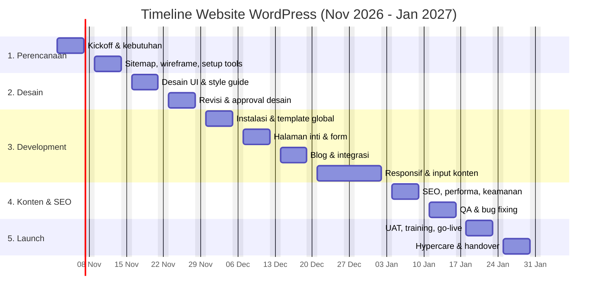

# Timeline Proyek Website WordPress (3 Bulan)

Rencana kerja pembuatan website WordPress dari nol sampai live dalam 13 minggu.
Tanggal di bawah memakai asumsi mulai **Senin, 2 November 2026** dan selesai
**Jumat, 29 Januari 2027**. Jika tanggal mulai bergeser, geser semua minggu
dengan jarak yang sama.

## Ringkasan

| Fase | Periode | Fokus | Output utama |
|---|---|---|---|
| 1. Discovery & Perencanaan | 2 – 13 Nov 2026 | Kebutuhan, struktur, tools | Brief, sitemap, wireframe, daftar plugin |
| 2. Desain | 16 – 27 Nov 2026 | Tampilan & style guide | Desain UI disetujui |
| 3. Development | 30 Nov – 31 Des 2026 | Build tema, halaman, fitur | Website lengkap di staging |
| 4. Konten, SEO & Optimasi | 4 – 15 Jan 2027 | Konten, SEO, performa, keamanan | Website siap UAT |
| 5. UAT, Launch & Handover | 18 – 29 Jan 2027 | Pengujian, go-live, serah terima | Website live + dokumentasi |

## Gantt Chart

## Rincian Mingguan

### Bulan 1 — November 2026

**Minggu 1 (2 – 6 Nov): Kickoff & kebutuhan**
- Meeting kickoff: tujuan website, target pengunjung, KPI (leads, pendaftar, traffic).
- Kumpulkan referensi website, logo, warna brand, dan aset foto.
- Tentukan domain, hosting (min. PHP 8.2, SSL, backup harian), dan email.
- Audit konten yang sudah ada (jika migrasi dari website lama).

**Minggu 2 (9 – 13 Nov): Sitemap, wireframe & tools**
- Susun sitemap: Beranda, Tentang, Layanan/Program, Event, Blog, Kontak.
- Wireframe low-fidelity untuk halaman utama.
- Pilih tema dan page builder (mis. Astra/GeneratePress + Gutenberg/Elementor).
- Daftar plugin: SEO (Rank Math/Yoast), form (WPForms/Fluent Forms), cache
  (LiteSpeed/WP Rocket), keamanan (Wordfence), backup (UpdraftPlus).
- Siapkan environment **staging**.

**Minggu 3 (16 – 20 Nov): Desain UI**
- Desain Beranda dan 2–3 halaman kunci (desktop + mobile) di Figma.
- Style guide: tipografi, warna, tombol, komponen kartu, form.

**Minggu 4 (23 – 27 Nov): Revisi & approval desain**
- Maksimal 2 putaran revisi.
- ✅ **Milestone 1 — Desain disetujui (Jumat, 27 Nov).**

### Bulan 2 — Desember 2026

**Minggu 5 (30 Nov – 4 Des): Instalasi & template global**
- Instal WordPress, tema, child theme, dan plugin dasar di staging.
- Header, footer, menu navigasi, halaman 404.

**Minggu 6 (7 – 11 Des): Halaman inti**
- Build Beranda, Tentang, Layanan/Program, Kontak.
- Form kontak/pendaftaran + notifikasi email (cek SMTP).

**Minggu 7 (14 – 18 Des): Blog & integrasi**
- Template blog, kategori, tag, halaman arsip, dan single post.
- Custom post type bila perlu (mis. Event/Program).
- Integrasi: Google Analytics 4, Search Console, tombol WhatsApp, media sosial,
  newsletter.
- ✅ **Milestone 2 — Semua fitur selesai di staging (Jumat, 18 Des).**

**Minggu 8–9 (21 Des – 31 Des): Responsif & input konten** *(buffer libur Natal & Tahun Baru)*
- Penyesuaian tampilan mobile dan tablet.
- Input konten final: teks, gambar (sudah dikompres), artikel awal (min. 5 artikel).
- Kapasitas kerja dikurangi; minggu ini sekaligus menjadi cadangan jika ada keterlambatan.

### Bulan 3 — Januari 2027

**Minggu 10 (4 – 8 Jan): SEO, performa & keamanan**
- SEO on-page: meta title/description, slug, schema, sitemap XML, robots.txt.
- Performa: cache, lazy load, konversi gambar ke WebP, target PageSpeed mobile ≥ 80.
- Keamanan: ganti URL/akun admin default, 2FA, batasi login, backup terjadwal.

**Minggu 11 (11 – 15 Jan): QA & bug fixing**
- Uji lintas browser (Chrome, Safari, Firefox) dan perangkat (Android, iOS).
- Cek semua link, form, notifikasi email, dan tampilan setiap halaman.
- Perbaiki temuan bug.
- ✅ **Milestone 3 — Siap UAT (Jumat, 15 Jan).**

**Minggu 12 (18 – 22 Jan): UAT, training & go-live**
- Senin–Selasa: UAT oleh klien/tim, perbaikan akhir.
- Rabu, 20 Jan: **Go-live** — backup staging, pindah ke production, arahkan DNS,
  aktifkan SSL, submit sitemap ke Search Console.
- Kamis–Jumat: training admin (menulis artikel, mengganti gambar, update plugin).
- ✅ **Milestone 4 — Website live (Rabu, 20 Jan).**

**Minggu 13 (25 – 29 Jan): Hypercare & handover**
- Monitoring error, uptime, form, dan analytics setelah live.
- Serah terima: akses (hosting, domain, WP admin), dokumentasi, panduan admin.
- Retrospektif proyek dan rencana maintenance bulanan.
- ✅ **Milestone 5 — Handover selesai (Jumat, 29 Jan).**

## Milestone & Persetujuan

| # | Milestone | Tanggal | Disetujui oleh |
|---|---|---|---|
| M1 | Desain UI disetujui | 27 Nov 2026 | Klien / Owner |
| M2 | Fitur lengkap di staging | 18 Des 2026 | Project Manager |
| M3 | Siap UAT (QA lulus) | 15 Jan 2027 | Project Manager |
| M4 | Website live | 20 Jan 2027 | Klien / Owner |
| M5 | Handover selesai | 29 Jan 2027 | Klien / Owner |

## Pembagian Peran

| Peran | Tanggung jawab |
|---|---|
| Project Manager | Jadwal, komunikasi, approval milestone |
| UI/UX Designer | Wireframe, desain UI, style guide |
| WordPress Developer | Instalasi, tema, plugin, fitur, deploy |
| Content Writer / SEO | Teks halaman, artikel, SEO on-page |
| Klien / Owner | Menyediakan aset & konten, review, UAT |

## Risiko & Antisipasi

| Risiko | Dampak | Antisipasi |
|---|---|---|
| Konten/aset dari klien terlambat | Development & input konten mundur | Deadline aset di Minggu 4; pakai placeholder dulu |
| Revisi desain berlebihan | Development mundur | Batasi 2 putaran revisi, approval tertulis |
| Libur akhir tahun | Kapasitas tim turun | Minggu 8–9 dijadikan buffer |
| Konflik plugin / update | Error setelah live | Uji update di staging, backup sebelum update |
| Propagasi DNS lambat | Website belum bisa diakses saat launch | Turunkan TTL DNS 2 hari sebelum go-live |

## Checklist Go-Live

- [ ] Backup penuh staging (file + database)
- [ ] Domain, DNS, dan SSL aktif
- [ ] Ganti URL staging ke domain production (search-replace database)
- [ ] Matikan "Discourage search engines" di Settings → Reading
- [ ] Permalink diatur ke `/%postname%/`
- [ ] Form terkirim dan email notifikasi diterima
- [ ] GA4 dan Search Console terpasang, sitemap disubmit
- [ ] Cache dan backup terjadwal aktif
- [ ] Akun admin kuat + 2FA, user yang tidak dipakai dihapus
- [ ] Uji ulang tampilan di mobile setelah live
